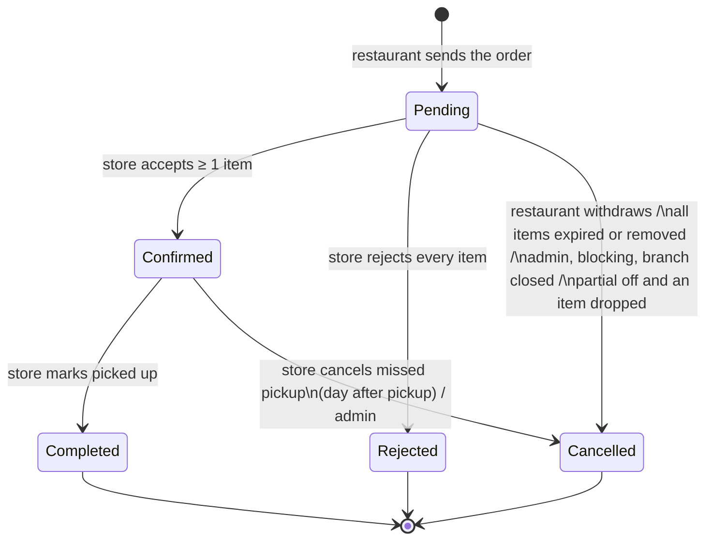
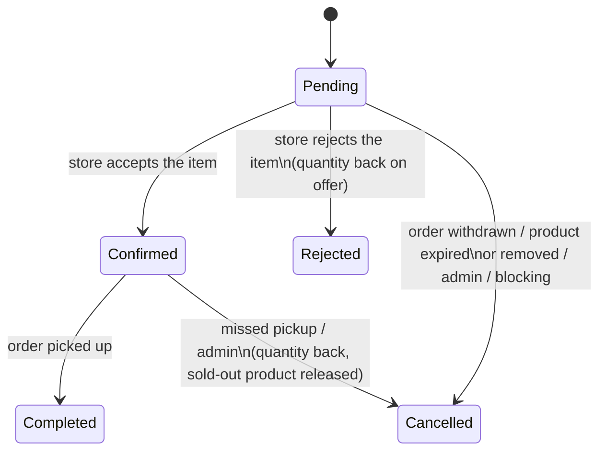

# Design: Orders and cart (phase 1 of "Orders and delivery")

Nov 6, 2026 · status: **agreed**, built in the PRs of section 11

Phase 1 of "Orders and delivery" in `development-plan.md`: a restaurant orders several products of one store at once from a cart, the store accepts or rejects each item, and the restaurant picks the order up (no delivery yet). Restaurants stop paying credits. This document follows the plan's agreed rules (one store per order, stores pay only credits, restaurants pay nothing, accepting per item, "Accept partial fulfilment") and leaves delivery (phase 2: ready time, `DeliveryProvider`, Korpa) out, but keeps room for it.

The app is not live and all data is test data: **no existing reservation, credit or history data is kept**. Schema changes go through normal migrations; the migrations may delete old test rows, and the demo data comes from the seed (`npm run seed` after `npm run migrate up`). The decisions are listed in section 12.

---

## 1. Data model

### Principle

A **reservation becomes an order item**. An `orders` table sits above the items; each item keeps what belongs to one product (product, quantity, agreed price, item status). The stock-safe rule stays exactly as it is ("available = quantity − Pending − Confirmed − Completed items").

The items table is today's `reservations`, extended with `order_id`. It keeps its name while the PRs switch the code over, and the last PR renames it to `order_items` (with the enum and leftover columns), so no "reservation" name stays in the code. The UI says "narudžba" / "order" and "stavka" / "item" from the first order PR on.

### `orders` (new)

| Column | Type | Notes |
|---|---|---|
| id | serial PK | used in URLs and the API |
| store_id | → users (RESTRICT) | the one store of the order; every item's product belongs to it |
| restaurant_id | → users (RESTRICT) | |
| code | char(4) NOT NULL | random short code, shown as `#K7PM` (section 9); unique `(store_id, code)` |
| status | `order_status` enum | `Pending`, `Confirmed`, `Completed`, `Rejected`, `Cancelled` (section 2); stored, always derived from the items in the same transaction |
| pickup_at | timestamp (no time zone) | local wall-clock pickup time (like `reservations.pickup_date` today), so `pickup_at::date` compares with `CURRENT_DATE` |
| accept_partial | boolean NOT NULL default true | "Accept partial fulfilment" |
| decided_at | timestamptz null | when the store accepted/rejected |
| picked_up_at | timestamptz null | when the store marked it picked up |
| created_at, updated_at | | `set_updated_at` trigger |

Indexes: `(restaurant_id, status)`, `(store_id, status)`, `(status, pickup_at)` (pickups, late logic, reminders), unique `(store_id, code)`.

Nothing about money is stored on the order: the total is the sum of its items (`unit_price × quantity`), the accepted total the sum of its Confirmed/Completed items. Phase 2 adds the fulfilment method, delivery address, fee and ready time as new columns.

### Items (`reservations`, renamed `order_items` in the last PR)

- Kept: `id`, `product_id`, `quantity`, `unit_price` (the agreed price), `status` (the **item status**, today's `reservation_status` enum, renamed `order_item_status`), `picked_up_at` (reports read it), `created_at`, `updated_at`.
- New: `order_id → orders (CASCADE)` NOT NULL, indexed; `decided_at timestamptz null` (when this item was accepted or rejected); unique `(order_id, product_id)`, so a product appears once per order.
- `restaurant_id` stays as an immutable copy of the order's (ownership checks and indexes use it); written once by the single insert path.
- `pickup_date` moves to `orders.pickup_at`. It stays on the items, written equal by the insert path, only until the last PR drops it (the admin and company queries that read it switch to the order in PR 3).

Every item's `products.store_id` equals `orders.store_id`; the insert path guarantees it and a test checks it.

### `order_status_history` (new)

One row per status change, of the order or of one item:

| Column | Notes |
|---|---|
| id | |
| order_id → orders (CASCADE) | |
| item_id → items (CASCADE), null | null = the order's status changed; set = one item's |
| from_status, to_status | varchar (an order or item status); `from_status` null on creation |
| source | `order_event_source` enum: `RESTAURANT`, `STORE`, `ADMIN`, `SYSTEM` (expiry job, blocking cascades, branch closed); phase 2 adds `PROVIDER` |
| actor_id → users (SET NULL), null | who did it (null for `SYSTEM`) |
| reason | text, null: an admin's reason |
| created_at | |

Index `(order_id, created_at)`. Written only by the order service (`syncOrderStatus` and the item status setter, section 2) in the action's transaction. Item rows are written only when items differ (a decision with rejections, an item cancelled by expiry or moderation); when all items move together, the order row alone describes it. The order details page shows the history as a timeline; the admin sees it with the actor's email.

### `cart_items` (new, section 4)

`restaurant_id → users (CASCADE)`, `product_id → products (CASCADE)`, `quantity` (numeric > 0), `unit_price_seen` (the price when added or last confirmed), `added_at`; primary key `(restaurant_id, product_id)`. The store follows from the products; the API keeps one store per cart.

### Other tables

- `notifications.order_id → orders (SET NULL)`, joined by `GET /notifications` and the email data. `notifications.reservation_id` stays for an item-level notification until the rename.
- `admin_actions.target_order_id → orders (SET NULL)` and a new admin action `CANCEL_ORDER`; `CANCEL_RESERVATION` is no longer written.
- Credit ledger: no schema change. `RESERVATION_CHARGE` / `RESERVATION_REFUND` are no longer written (section 7); the enum values stay, since Postgres cannot drop enum values without rebuilding the type, which is not worth it.

### Old test data

The migration that adds orders deletes every reservation (their notifications go with them; admin actions keep their row with the reservation link set to null) and the ledger's reservation rows (inside the ledger's maintenance switch). Afterwards the seed rebuilds a realistic set (section 8, Seed). Developers run `npm run migrate up` and `npm run seed`; CI starts from an empty database anyway.

---

## 2. Statuses

### Item status (today's reservation statuses)

| Item | Meaning |
|---|---|
| `Pending` | waiting for the store |
| `Confirmed` | accepted by the store, waiting for pickup |
| `Completed` | picked up |
| `Rejected` | refused by the store (its quantity is free again) |
| `Cancelled` | withdrawn by the restaurant, cancelled by expiry, an admin, blocking or moderation, a deactivated branch, or a missed pickup |

### Order status

| Order | UI (bs / en) | Meaning |
|---|---|---|
| `Pending` | Čeka odgovor / Waiting | the store has not decided yet |
| `Confirmed` | Prihvaćena / Accepted | at least one item accepted, waiting for pickup |
| `Completed` | Preuzeta / Picked up | handed over |
| `Rejected` | Odbijena / Rejected | the store accepted nothing |
| `Cancelled` | Otkazana / Cancelled | withdrawn, expired, cancelled by an admin, closed, or a missed pickup |

"Partially accepted" is **not a status**: it is a `Confirmed` (or later `Completed`) order with some `Rejected` items; cards show "2 od 3 stavke prihvaćene" from the item counts. Fewer statuses keep every filter, statistic and colour map simple.

### The order follows its items

`syncOrderStatus(client, orderId, { source, actorId, reason })` derives the order status from its items after every item change, in the same transaction, and writes a history row when it changes:

1. any item `Pending` → `Pending`
2. else any item `Completed` → `Completed`
3. else any item `Confirmed` → `Confirmed`
4. else any item `Rejected` → `Rejected`
5. else (all `Cancelled`) → `Cancelled`

| Items | Order |
|---|---|
| 3 Pending | Pending |
| 2 Confirmed + 1 Rejected | Confirmed (partially accepted) |
| 3 Rejected | Rejected |
| 1 Cancelled by an admin (product removed) + 2 Rejected by the store | Rejected (the store refused everything that was left) |
| 2 Confirmed + 1 Rejected, then picked up | Completed (the 2 become Completed, the Rejected stays) |
| 2 Confirmed + 1 Rejected, missed pickup | Cancelled (the 2 become Cancelled) |
| 3 Cancelled (restaurant withdrew) | Cancelled |

Rules that keep it unambiguous:

- **The store decides the whole order in one step** (section 6), so an order never sits half-decided; only system events (expiry, moderation) touch single Pending items.
- **Pickup, missed pickup and an admin's cancel act on the whole order**: all its `Confirmed` items move together. No partial pickup.
- **The restaurant cancels the whole order** while it is Pending; no single-item cancel.
- With `accept_partial = false`, any event that leaves the order only partly fulfillable cancels it: an item cancelled by expiry or moderation while Pending cancels the rest too (both sides are told why).

### State diagrams

Order:



Item:



`Completed`, `Rejected` and `Cancelled` are final for both.

---

## 3. Existing data

Nothing is migrated (see "Old test data" in section 1): the schema arrives by migration, old reservations and their credit rows are deleted, and the seed creates the demo orders. There is no history reconstruction and no before/after comparison of reports.

---

## 4. The cart

### Where it lives: on the server

A `cart_items` table and a small `/api/cart` API, not `localStorage`:

- Restaurants order from phones and computers; a server cart is the same on every device and for every staff member using the account.
- The server answers each cart line with live data (current price, available quantity, sold out, expired, store blocked), so the cart never shows stale stock.
- `localStorage` would keep a cart across logins on a shared device and need its own versioning when the product shape changes.

### Rules

- **One store per cart.** Adding a product from another store answers `409 { code: "CART_OTHER_STORE", store_name }`; the client asks "Isprazniti korpu? U korpi su proizvodi iz {store}. Narudžba može biti samo iz jedne prodavnice." with "Isprazni i dodaj" (sends again with `replace: true`) or "Odustani".
- **No stock is held.** A cart line reserves nothing; another restaurant can buy the last kilo. The cart says so: "Proizvodi u korpi nisu rezervisani dok ne pošaljete narudžbu."
- Adding a product that is already in the cart sets the line's quantity. Quantity > 0 and at most the available quantity at that moment.
- At most 30 lines (`MAX_ORDER_ITEMS`, also the order limit).
- Pickup time and "Accept partial fulfilment" are chosen at checkout, not stored in the cart.

### When the offer changes before the order is sent

`GET /cart` returns each line with the product's current state and flags; the cart shows them and blocks sending until they are resolved:

| Situation | Flag | Cart shows | Restaurant can |
|---|---|---|---|
| Sold out (available 0), expired, removed, store blocked or branch deactivated | `unavailable` (+ reason) | the line greyed out, "Više nije dostupno" | only remove it ("Ukloni nedostupne" removes all such lines) |
| Available < cart quantity | `quantity_exceeds` (+ `available_quantity`) | "Dostupno još samo 2 kg" | "Smanji na 2 kg" or remove |
| Price changed since added | `price_changed` (+ old and new) | old price struck through, the new one and the new total | continue (confirming updates `unit_price_seen`) |
| An item expires before the chosen pickup day | checked at checkout | the date picker's max is the earliest expiry among the lines | pick an earlier day |

Lines of a removed or expired product are deleted by the midnight expiry job one day later, so the restaurant still sees why a line disappeared. Lines of a blocked store stay (unblocking brings them back) but are `unavailable`.

Restaurants get a cart icon with the line count in the header, next to notifications.

---

## 5. Sending an order

`POST /api/orders` (RESTAURANT):

```json
{
  "pickup_at": "2026-11-07T14:30",
  "accept_partial": true,
  "items": [{ "product_id": 12, "quantity": 2, "unit_price": "3.50" }]
}
```

The client sends exactly what the restaurant saw, prices included. In **one transaction**:

1. Validate the body: 1–30 items, each quantity > 0, no product twice, `pickup_at` a valid date-time (`"Pickup date is not valid."`).
2. **Pending-order limit** (section 6): a transaction-scoped advisory lock on the restaurant id (`pg_advisory_xact_lock`), then count its Pending orders, so two parallel orders cannot both pass the limit.
3. **Lock every product `FOR UPDATE` in ascending id order** (today's stock-safe pattern extended to many rows; a fixed order prevents deadlocks between orders that share products). Products must be visible (`visibleStore`), `Available`, not expired, and all of one store.
4. Per product: available = `quantity − SUM(Pending, Confirmed, Completed items)`, exactly as today.
5. Check everything before writing anything; if any line fails, nothing is created:
   - a product gone (removed, expired, store blocked or deactivated) → `409 { code: "ITEMS_UNAVAILABLE", items }`;
   - a price different from the one sent → `409 { code: "PRICE_CHANGED", items: [{ product_id, unit_price }] }`;
   - more than is available → `409 { code: "NOT_ENOUGH_QUANTITY", items: [{ product_id, requested, available }] }`;
   - products of different stores → 400 `"An order can contain products of one store only."`;
   - `pickup_at` outside today … the earliest expiry among the products → 400 `"Pickup date must be between today and the products' expiry date."`.
   - A 409 lists every failing line, not only the first.
6. Insert the order with a fresh code (section 9), the items with the current prices, the history row; remove those products from the cart; notify the store once (`ORDER_CREATED`); commit. 201 `{ message: "Order sent.", order }`.

**When an item no longer has enough quantity, the server never adjusts it; the restaurant chooses.** The 409 opens a dialog listing each short line ("Piletina: tražili ste 5 kg, dostupno je još 2 kg") with "Smanji na 2 kg" or "Ukloni" per line (only "Ukloni" when nothing is left), and "Pošalji ispravljenu narudžbu" or "Nazad u korpu". The choice updates the cart lines and sends again; a new shortage repeats the dialog. An automatic adjustment would change the total behind the restaurant's back and may make the order pointless (it wanted 5 kg for a menu). `PRICE_CHANGED` and `ITEMS_UNAVAILABLE` use the same dialog with their own texts.

No credit is charged (section 7).

---

## 6. Accepting per item, partial fulfilment, the pending limit

### The store's decision

`POST /api/orders/:id/decision` (STORE, owner), body `{ items: [{ item_id, accept: true|false }] }` with **every Pending item exactly once**. One transaction: lock the order, then its products in ascending id order; 400 when:

- the order is not Pending: `"Only pending orders can be accepted or rejected."`;
- the list does not cover every Pending item exactly once: `"Decide every item of the order."`;
- `accept_partial = false` and the decisions are mixed: `"This order must be accepted in full or rejected."`;
- an accepted item's product has expired: `"An expired product cannot be accepted."`.

Then items become Confirmed / Rejected with `decided_at`; `markSoldIfFullyConfirmed` runs for each accepted product (with `PRODUCT_SOLD_OUT` as today); rejected items free their quantity by themselves (the available-quantity formula ignores Rejected); `syncOrderStatus`; one notification to the restaurant: `ORDER_ACCEPTED` (all), `ORDER_PARTIALLY_ACCEPTED` (some, listing what was rejected) or `ORDER_REJECTED` (none).

UI: the store opens the order and sees each item with a toggle (Prihvati / Odbij, default Prihvati) and two buttons: "Potvrdi odluku" (a confirmation with the summary "Prihvatate 2 stavke (14,00 KM), odbijate 1") and the shortcut "Odbij narudžbu". With partial fulfilment off the toggles are replaced by the note "Restoran prihvata samo cijelu narudžbu" and the buttons "Prihvati sve" and "Odbij narudžbu". Accepting stays irreversible.

The store cannot accept a smaller quantity of an item: it has the published quantity (which is locked) or rejects the item.

### "Accept partial fulfilment"

A checkbox at checkout, **on by default**: "Prihvatam djelimičnu isporuku: prodavnica može prihvatiti samo neke stavke." Off means all or nothing: the store can only accept everything or reject the order, and if an item drops out before the decision (expired, removed by an admin), the whole order is cancelled. Both sides see the setting on the order.

### Limit on pending orders

Without credits, nothing would stop a restaurant from flooding stores with orders. **At most 10 Pending orders per restaurant** across all stores, one constant (`MAX_PENDING_ORDERS` in the order service; changing it is a one-line change). An 11th is refused with 409 `"You have too many orders waiting for an answer (10). Wait for the stores to respond or cancel one."` (the number comes from the constant); the cart shows the count from 8 pending on. Checked under the advisory lock of section 5.

---

## 7. Credits: restaurants pay nothing

### What changes

- **Charging and refunds:** creating an order charges nothing, and no path refunds a restaurant (store reject, restaurant cancel, expiry, admin cancel, blocking, branch deactivation). `chargeForReservation`, `refundForReservation` and their tests are removed.
- **Credit API:** `/api/credits` is STORE-only (`authorize("STORE")`); a restaurant gets the role 403, like a headquarters today. The renewal job, `grantPlan`, `grantTopup` and `adjustCredits` accept only stores (`"Credits apply only to stores."`, replacing "stores and restaurants").
- **Restaurant UI removed:** the Credits sidebar link and page, `CreditBanner`, `CreditHint` and `InsufficientCreditsNotice` in the reservation (later checkout) flow, the subscription and top-up cards on My profile; `CreditsProvider` is enabled for stores only; `/credits` for a restaurant redirects to the dashboard.
- **Admin:** the credits overview lists stores only (the role filter goes); the platform overview's subscription numbers count stores only; a restaurant's admin page has no credits card; the requests page can only contain stores' requests.
- **Seed:** restaurants get no subscriptions, requests or ledger rows.
- **Existing restaurant data:** none is kept or refunded (test data). Old rows in a developer's database stay harmless (the API never shows them) until the reseed.
- **Texts and docs:** the subscription explanation dialog, `credits-spec.md`, `product.md` Credits.

### What stays the same for stores

1 credit per published product (also CSV import), the same-day refund rules for deleting and moving to donations, plans, top-ups, auto-renew, banners, the Credits page, branches paid by their headquarters. `refundForProduct`'s "nothing reserved" check counts Pending/Confirmed/Completed items, the same query.

---

## 8. Everything that touches reservations today

| Area | Today | With orders |
|---|---|---|
| **Ordering** | `ReserveProductModal` on product details, store profile and marketplace | "Dodaj u korpu" (quantity only) on the same places; checkout on `/cart`. Until the cart PR the modal sends a one-item order |
| **Restaurant list** | My reservations (Active / History tabs, filters, sorts, summary) | "Moje narudžbe": the same tabs, filters (store, period, status, product name matching any item), sorts and summary over orders; a card shows store, `#K7PM`, item count, total, pickup, status (+ "2/3 prihvaćeno") |
| **Store list** | Reservations, Pending first | "Narudžbe": the same filters plus the code; Pending first |
| **Details** | `/reservation/:id` | `/orders/:id`: code, status, pickup, partial setting; the item table (product, quantity, agreed price, item status, line total) and totals; the other party; actions; the history timeline |
| **Pickups and late logic** | per reservation; late = `pickup_date::date < CURRENT_DATE` | per order with the same rules on `pickup_at`: Today / Upcoming / Picked up; "Preuzeto" and "Otkaži propušteno" act on the whole order; counts and the red dot count orders |
| **Expiry job** | cancels Pending reservations of expired products, refunds, notifies per reservation | cancels Pending **items** of expired products (no refund), then `syncOrderStatus` per order (nothing left → Cancelled; partial off → the whole order Cancelled); one `ORDER_ITEMS_EXPIRED` or `ORDER_EXPIRED` per order; `PRODUCT_EXPIRED` to the store unchanged; Confirmed items untouched; stale cart lines removed |
| **Reminders** | `PICKUP_TODAY` per Confirmed reservation; `PRODUCT_EXPIRING_SOON` per product with Pending requests | `ORDER_PICKUP_TODAY` per Confirmed order (once per order); `PRODUCT_EXPIRING_SOON` unchanged (Pending items) |
| **Notifications and emails** | one per reservation event | **one per order event** (below); the emails show the item table |
| **Reports** | Completed reservations by `picked_up_at`, one row each | the same rows (Completed items by `picked_up_at`); the sales report's reservation number column becomes "Narudžba" (`#K7PM`); impact "pickups" counts orders |
| **Statistics** | store profile: sold products, successful deliveries, "your reservations here"; dashboards: pending, confirmed, food saved, savings | **orders** for deliveries, pickups and status cards ("successful deliveries", "your orders here", pending, accepted, admin status counts, impact pickups); **items** for food saved, value and savings (unchanged) |
| **Company (HQ)** | branch page shows the branch's reservations; stats `pending_reservations`, `reservations_this_month`, `completed_this_month`; dashboard, reports | the branch's orders (read-only); the same stats over orders; reports as above |
| **Admin reservations** | list, filters, sort by pickup, cancel Pending/Confirmed with a reason | "Narudžbe": orders (code, store, restaurant, items, total, pickup + late, status), filters (status, user on either side, search by product, business or code), a details view with items and history, **cancel the whole order** (Pending or Confirmed) with a required reason, both sides notified (`ORDER_CANCELLED_BY_ADMIN`), action `CANCEL_ORDER`; Confirmed items release their products as today |
| **Admin user page and overview** | reservation counts on both sides; "reservations by status" | the same over orders |
| **Blocking a user or company** | cancels Pending reservations on both sides (refund, notify); Confirmed stay | cancels Pending **orders** on both sides, the other side notified once per order; Confirmed stay |
| **Removing a product (moderation)** | cancels its Pending reservations | cancels its Pending **items**; `syncOrderStatus`; orders with partial off or nothing left are cancelled; restaurants notified per order |
| **Branch deactivation** | refused while Confirmed reservations exist; cancels Pending | refused while Confirmed **orders** exist; cancels Pending orders (`ORDER_CANCELLED_STORE_CLOSED`) |
| **Deleting a product, moving to donations** | counts Pending/Confirmed/Completed reservations | the same over items |
| **Seed** | reservations with credit charges | see below |

### Notification types

| Type | To | When |
|---|---|---|
| `ORDER_CREATED` | store | a restaurant sends an order |
| `ORDER_ACCEPTED` / `ORDER_PARTIALLY_ACCEPTED` / `ORDER_REJECTED` | restaurant | the store's decision |
| `ORDER_CANCELLED` | store | the restaurant withdraws it |
| `ORDER_ITEMS_EXPIRED` / `ORDER_EXPIRED` | restaurant | the expiry job cancels some / all of its Pending items |
| `ORDER_ITEMS_REMOVED` | restaurant | moderation cancels some Pending items (the whole order → `ORDER_CANCELLED_BY_ADMIN`) |
| `ORDER_COMPLETED` | restaurant | picked up |
| `ORDER_PICKUP_MISSED` | restaurant | the store cancels a missed pickup |
| `ORDER_CANCELLED_BY_ADMIN` | the other side (blocking, without reason); both sides (an admin's cancel, with reason) | |
| `ORDER_CANCELLED_STORE_CLOSED` | restaurant | branch deactivated |
| `ORDER_PICKUP_TODAY` | restaurant | 07:00 reminder |

They replace the `RESERVATION_*` types and `PICKUP_TODAY`, which are removed with their translations and email templates. Each new type has its email template (`NOTIFICATION_TEMPLATES` is a `Record`, so the typecheck enforces it), client translation, `NOTIFICATION_META` entry and the link `/orders/:id`. Subjects carry the code: "Nova narudžba #K7PM od {restaurant}".

### Locking

One rule for every order path: **the order(s) first (ascending id), then the products (ascending id), then the store's subscription.** Paths that start from a product (moderation, expiry) first select and lock the affected Pending orders, then the product, so they cannot deadlock with a store's decision.

### Seed

The demo seed builds orders through the same SQL shapes the app writes (orders, items, history, codes, notifications), spread over the last weeks and the coming days:

- orders of 1 to 5 items, from several restaurants to independent stores and to the chain's branches (Bingo branches in different cities);
- every order status: Pending (including some with partial fulfilment off), Confirmed for today and later, Completed with `picked_up_at` in the past weeks (so reports, dashboards and the impact counter have data), Rejected, Cancelled by the restaurant, by expiry, by an admin (with reason and audit row) and missed pickups;
- at least one **partly accepted** order (Confirmed with a Rejected item) and one partly accepted that was then picked up;
- **late pickups**: Confirmed orders whose pickup day was yesterday and three days ago;
- history rows for every order matching its path, the notifications each step would have sent (no emails), and items that keep stock consistent (no product oversold; sold-out products where accepted items cover the quantity);
- **restaurants without subscriptions, requests or credit history**; stores and branches keep theirs.

---

## 9. The short order code

- **Format:** 4 characters from `ABCDEFGHJKLMNPQRSTUVWXYZ23456789` (letters and digits without 0, O, 1 and I), shown as `#K7PM`. 32⁴ ≈ 1 million codes per store.
- **Random, not a sequence:** it does not reveal how many orders a store gets.
- **Uniqueness:** unique within a store (`UNIQUE (store_id, code)`). The order insert draws a code with `crypto.randomInt` and uses `INSERT ... ON CONFLICT (store_id, code) DO NOTHING RETURNING id`; on a collision it draws again (at most 10 tries, then a 500 that is practically impossible: even a store with 10 000 orders has a 1% chance of one retry). Two stores can both have a `#K7PM`, so the code is always shown with the store or restaurant name, and URLs use the order id.
- **Where it shows:** order cards and details (title "Narudžba #K7PM"), pickup cards, the store's decision confirmation, notifications and email subjects, the admin orders list, the search of the store's and the admin's order lists (case-insensitive), the CSV sales reports.
- One helper on each side (`formatOrderCode`, adding `#`) and one generator on the server (`generateOrderCode`).

---

## 10. API changes

### New

| Endpoint | Who | Notes |
|---|---|---|
| `GET /api/cart` | RESTAURANT | `{ store, items: [{ product fields, quantity, unit_price_seen, available_quantity, flags }], totals, pending_orders }` |
| `PUT /api/cart/items/:productId` | RESTAURANT | `{ quantity, replace? }`; 409 `CART_OTHER_STORE`; 400 quantity rules; 404 product |
| `DELETE /api/cart/items/:productId`, `DELETE /api/cart`, `DELETE /api/cart/unavailable` | RESTAURANT | remove a line / empty the cart / remove the flagged lines |
| `POST /api/orders` | RESTAURANT | section 5 |
| `GET /api/orders/mine`, `GET /api/orders/mine/summary` | RESTAURANT | today's `/reservations/mine` filters, sorts, scopes and paging, over orders |
| `GET /api/orders/store` | STORE | today's `/reservations/store` filters plus `code` |
| `GET /api/orders/pickups`, `GET /api/orders/pickups/counts` | STORE, RESTAURANT | today's `/reservations/pickups` rules over orders |
| `GET /api/orders/:id` | the two parties | order + items + both parties + history; 404 for anyone else |
| `POST /api/orders/:id/decision` | STORE | section 6 |
| `POST /api/orders/:id/cancel` | RESTAURANT | Pending only |
| `POST /api/orders/:id/complete` | STORE | Confirmed only |
| `POST /api/orders/:id/cancel-overdue` | STORE | Confirmed, pickup day passed |
| `GET /api/admin/orders`, `GET /api/admin/orders/:id`, `POST /api/admin/orders/:id/cancel` | ADMIN | section 8 |
| `GET /api/company/branches/:id/orders` | COMPANY | read-only, the store's list |

Actions are `POST /orders/:id/<action>` (an action with a body, not a field update).

### Changed

- `GET /api/dashboard/stats`, `GET /api/users/stores/:id`, `GET /api/admin/stats`, `GET /api/admin/users/:id`, `GET /api/company/dashboard`, `GET /api/company/branches[/:id]`: reservation counts become order counts with renamed fields (`pending_orders`, …), changed together with the client.
- `GET /api/notifications`: rows add `order_id`, `order_code`, `order_item_count`, `order_store_name`.
- `GET /api/reports/sales` and the company sales report: the order code column.
- `/api/credits/*`: STORE only; `GET /api/admin/credits/overview`: stores only.
- Admin block, company block, product removal and branch deactivation: `cancelledReservations` in their responses becomes `cancelledOrders`.

### Removed

Every `/api/reservations` endpoint, `GET /api/admin/reservations`, `POST /api/admin/reservations/:id/cancel` and `GET /api/company/branches/:id/reservations`, each in the PR that moves its client to the order endpoints (no old endpoint is kept alive afterwards).

---

## 11. PRs

Each PR leaves the app working with its tests (server, client, e2e) passing, and updates the docs (`backend.md`, `frontend.md`, `product.md`, `e2e.md`, the plan's checkboxes) for what it finished.

1. **Restaurants without credits.** No charge or refund for reservations (the functions and their tests go); `/credits` STORE-only; grants, adjustments and the renewal job only for stores; restaurant credit UI removed; admin credits overview and overview numbers for stores; seed without restaurant subscriptions, requests or ledger rows; `credits-spec.md` and `product.md`. Ticks the plan's "Restaurants without credits" part (the pending limit comes with orders in PR 2).
2. **Orders for restaurants and stores.** Migration (orders, history, codes, `order_id` and `decided_at` on the items, notification and admin-action links, old reservation rows deleted); the order service (create with 1–30 items and the 409s, the pending limit, decision with partial fulfilment, cancel, complete, cancel-overdue, `syncOrderStatus`, history, codes); `/api/orders` lists, details, actions and pickups; the expiry and reminder jobs, blocking, product removal and branch deactivation on orders; the order notification types with emails and translations. Client: "Moje narudžbe", the store's "Narudžbe", order details with the per-item decision and history, Pickups by order, `ReserveProductModal` sending a one-item order, "narudžba" wording on these pages and in notifications. The `/api/reservations` endpoints and the old pages go. Seed with multi-item orders in every status (the store side already handles them). E2E: the reservation specs become order specs.
3. **Admin, headquarters, statistics and reports.** Admin "Narudžbe" (list, details with history, cancel with reason) replacing admin reservations; the company's branch orders; dashboards, store profile, admin overview and user page, company dashboard and branch stats counting orders; reports with the order code and order pickups; the remaining "rezervacija" wording. Items' `pickup_date` stops being read anywhere.
4. **Cart and checkout.** `cart_items` and `/api/cart`, the header cart, "Dodaj u korpu" replacing `ReserveProductModal`, `/cart` with the flags, checkout (pickup within the earliest expiry, partial fulfilment, the pending count), the shortage / price / unavailable dialog, stale lines removed by the expiry job. E2E: cart with the other-store dialog, checkout with a shortage, partial acceptance, partial off.
5. **Cleanup.** Rename `reservations` → `order_items` (and `reservation_status` → `order_item_status`, `notifications.reservation_id` → `order_item_id`), drop the items' `pickup_date`, remove what no longer has a use (`CANCEL_RESERVATION` handling, reservation helpers and names in code), tick the plan's phase 1 and describe orders fully in `product.md`.

PR 2 is the largest: once items belong to orders, every place that changes an item's status must keep its order in step, and the old reservation pages cannot show multi-item orders correctly, so the server and client parts land together. It stays one concern (the order model and its two parties) and is built in small commits.

---

## 12. Decisions

| # | Question | Decision |
|---|---|---|
| 1 | Cart on the server or in the browser? | **Server** (section 4). |
| 2 | Pickup time only on the order? | **Yes**: `orders.pickup_at`; the items' `pickup_date` is dropped in PR 5. |
| 3 | Can the store accept a smaller quantity? | **No.** |
| 4 | Can the restaurant cancel a single item? | **No**, only the whole Pending order. |
| 5 | Partial pickup? | **No**: pickup and missed pickup act on the whole order. |
| 6 | Restaurants' existing subscriptions? | **Not relevant** (test data): the seed gives restaurants none; no transition or refund logic. |
| 7 | Pending-order limit? | **10 per restaurant**, one constant `MAX_PENDING_ORDERS`. |
| 8 | Order number? | **Random 4-character code** without 0, O, 1, I, unique within a store, shown as `#K7PM` (section 9). |
| 9 | Orders or items in statistics? | **Orders** for deliveries, pickups and status cards; **items** for food saved and money. |
| 10 | Sales report column? | **The order code** replaces the reservation number; one row per item. |
| 11 | Wording? | **"narudžba" / "order"** replaces "rezervacija" / "reservation" everywhere in the UI; "stavka" / "item" for a line. |
| 12 | Notifications per order or per item? | **Per order**; item-level only where a single item changes (expiry, moderation). |
| 13 | Maximum lines per cart and order? | **30** (`MAX_ORDER_ITEMS`). |
| 14 | A reason when the store rejects? | **Not in phase 1**. |
| 15 | Automatic rejection when the store does not answer? | **Stays in phase 2** (plan); until then a Pending order waits until its products expire. |
