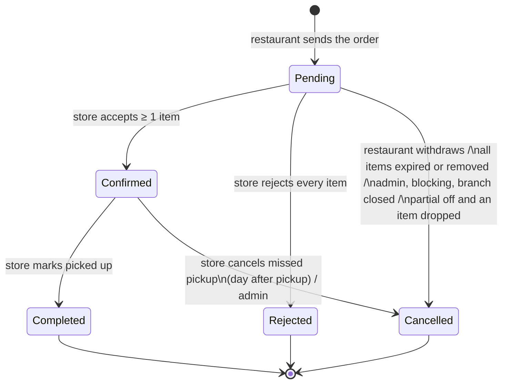
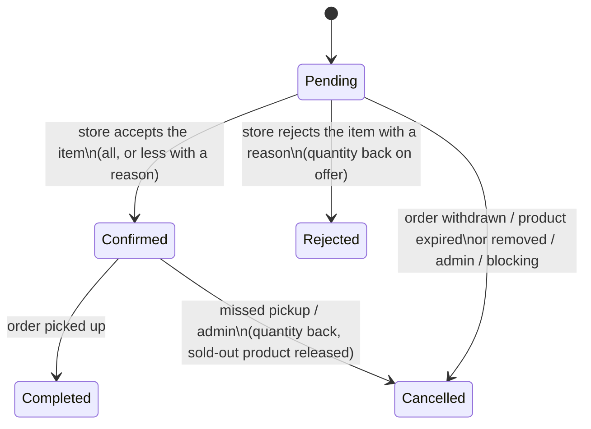

# Design: Orders and cart (phase 1 of "Orders and delivery")

Nov 6, 2026 · status: **agreed** (revised the same day: fulfilment method, partial fulfilment with quantities and reasons, partial sending, "Sold in shop"), built in the PRs of section 11

Phase 1 of "Orders and delivery" in `development-plan.md`: a restaurant orders several products of one store at once from a cart, the store accepts or rejects each item, and the restaurant picks the order up (no delivery yet). Restaurants stop paying credits. This document follows the plan's agreed rules (one store per order, stores pay only credits, restaurants pay nothing, accepting per item, "Accept partial fulfilment") and leaves delivery (phase 2: ready time, `DeliveryProvider`, Korpa) out, but keeps room for it.

The app is not live and all data is test data: **no existing reservation, credit or history data is kept**. Schema changes go through normal migrations; the migrations may delete old test rows, and the demo data comes from the seed (`npm run seed` after `npm run migrate up`). The decisions are listed in section 12.

---

## 0. The order flow (restaurant)

1. The restaurant adds products of **one store** to the cart ("Dodaj u korpu" on the marketplace, the store page or the product page).
2. At checkout it picks the pickup day and time, and ticks **"Accept partial fulfilment"** (on by default).
3. It sends the order and **sees at once what was sent**: the order code and total, and every change made at sending (a smaller quantity, a lower price, lines not sent because they sold out or got more expensive, which stay in the cart). No notification is needed for that.
4. The order appears under **Narudžbe → Aktivne** as pending ("Čeka odgovor").
5. The store decides (section 6). The restaurant gets a **notification and an email**: fully accepted, **partly accepted** (each changed line with its reason, "Piletina: 15 kg od 20 kg", and the new total) or **rejected** (with the reason). It does not confirm anything again: the checkbox was its consent.
6. It follows the order until pickup (Preuzimanja → Danas / Uskoro, and the reminder on the morning of the pickup); the store marks it picked up.
7. The order moves to **Narudžbe → Historija** (so do rejected, cancelled and missed ones).

The store side: a notification and an email for each new order, the decision dialog (section 6), and the pickup on its Preuzimanja page.

---

## 1. Data model

### Principle

A **reservation becomes an order item**. An `orders` table sits above the items; each item keeps what belongs to one product (product, ordered and current quantity, agreed price, item status, the store's reason for a change). The stock-safe rule keeps its shape and gains the shop sales (section 6a): **available = quantity − (Pending + Confirmed + Completed items) − sold in shop**, where an item counts with its current `quantity` (the accepted quantity once the store decided).

The items table is today's `reservations`, extended with `order_id`. It keeps its name while the PRs switch the code over, and the last PR renames it to `order_items` (with the enum and leftover columns), so no "reservation" name stays in the code. The UI says "narudžba" / "order" and "stavka" / "item" from the first order PR on.

### `orders` (new)

| Column | Type | Notes |
|---|---|---|
| id | serial PK | used in URLs and the API |
| store_id | → users (RESTRICT) | the one store of the order; every item's product belongs to it |
| restaurant_id | → users (RESTRICT) | |
| code | char(4) NOT NULL | random short code, shown as `#K7PM` (section 9); unique `(store_id, code)` |
| status | `order_status` enum | `Pending`, `Confirmed`, `Completed`, `Rejected`, `Cancelled` (section 2); stored, always derived from the items in the same transaction |
| fulfilment_method | `fulfilment_method` enum NOT NULL default `PICKUP` | phase 1 writes only `PICKUP`; phase 2 adds `DELIVERY` (Korpa) with an `ALTER TYPE ... ADD VALUE`, so no refactor |
| pickup_at | timestamp (no time zone) | local wall-clock pickup time (like `reservations.pickup_date` today), so `pickup_at::date` compares with `CURRENT_DATE`; required for `PICKUP` |
| accept_partial | boolean NOT NULL default true | "Accept partial fulfilment" |
| decided_at | timestamptz null | when the store accepted/rejected |
| send_changes | jsonb NOT NULL default `[]` | what changed when the order was sent (section 5): each `{ product_id, name, unit, kind, requested, sent, old_price, new_price }` with `kind` `QUANTITY_REDUCED`, `PRICE_LOWERED`, `NOT_SENT_SOLD_OUT`, `NOT_SENT_PRICE_RAISED`; a snapshot for the confirmation screen and the order details, never queried |
| picked_up_at | timestamptz null | when the store marked it picked up |
| created_at, updated_at | | `set_updated_at` trigger |

Indexes: `(restaurant_id, status)`, `(store_id, status)`, `(status, pickup_at)` (pickups, late logic, reminders), unique `(store_id, code)`.

Nothing about money is stored on the order: the total is the sum of its items (`unit_price × quantity`), the accepted total the sum of its Confirmed/Completed items. **Room for phase 2, not built now:** nullable `delivery_address`, `delivery_lat`/`delivery_lng`, `ready_at`, `delivery_fee`, `provider`, `provider_delivery_id` and `provider_status` columns, added by phase 2's migration; with `DELIVERY` the `pickup_at` requirement becomes a `ready_at` one (a CHECK per method). No phase 1 code reads `pickup_at` without going through the order, so that change stays local.

### Items (`reservations`, renamed `order_items` in the last PR)

- Kept: `id`, `product_id`, `quantity`, `unit_price` (the agreed price), `status` (the **item status**, today's `reservation_status` enum, renamed `order_item_status`), `picked_up_at` (reports read it), `created_at`, `updated_at`.
- `quantity` is the item's **current** quantity: what was sent while Pending, the **accepted** quantity once the store decided (never more than ordered). Stock, pickup, reports, statistics and totals all read `quantity`, so a smaller accepted quantity needs no special case anywhere.
- New: `ordered_quantity` NOT NULL (what the order sent, kept for history; CHECK `quantity <= ordered_quantity`); `order_id → orders (CASCADE)` NOT NULL, indexed; `decided_at timestamptz null`; `change_reason` (`order_change_reason` enum: `NOT_ENOUGH_STOCK`, `QUALITY`, `OTHER`, null) and `change_note` (text, at most 300 characters): set when the store accepted a smaller quantity or rejected the item (also for a whole-order rejection, which writes the same reason on every item); the decision API requires a reason for a reduced or rejected item (PR 3a's temporary reservation endpoints reject without one, so the database only CHECKs that `OTHER` has a note); unique `(order_id, product_id)`, so a product appears once per order.
- `restaurant_id` stays as an immutable copy of the order's (ownership checks and indexes use it); written once by the single insert path.
- `pickup_date` moves to `orders.pickup_at`. It stays on the items, written equal by the insert path, only until the last PR drops it (the admin and company queries that read it switch to the order in PR 4).

Every item's `products.store_id` equals `orders.store_id`; the insert path guarantees it and a test checks it.

### `order_status_history` (new)

One row per status change, of the order or of one item:

| Column | Notes |
|---|---|
| id | |
| order_id → orders (CASCADE) | |
| item_id → items (CASCADE), null | null = the order's status changed; set = one item's |
| from_status, to_status | varchar (an order or item status); `from_status` null on creation |
| source | `order_event_source` enum: `RESTAURANT`, `STORE`, `ADMIN`, `SYSTEM` (expiry job, blocking cascades, branch closed); phase 2 adds `PROVIDER` |
| actor_id → users (SET NULL), null | who did it (null for `SYSTEM`) |
| reason | text, null: an admin's reason |
| created_at | |

Index `(order_id, created_at)`. Written only by the order service (`syncOrderStatus` and the item status setter, section 2) in the action's transaction. Item rows are written only when items differ (a decision with rejections, an item cancelled by expiry or moderation); when all items move together, the order row alone describes it. The order details page shows the history as a timeline; the admin sees it with the actor's email.

### `product_shop_sales` (new, section 6a)

One row per "Sold in shop" entry: `id`, `product_id → products (CASCADE)`, `store_id → users (CASCADE)`, `quantity` (numeric > 0), `created_by → users (SET NULL)` (the store login that recorded it), `order_id → orders (SET NULL)` (set when it was recorded from an order decision), `created_at`. Index `(product_id)`. Append-only in practice (no edit or delete route). Never counted as an app sale.

### `cart_items` (new, section 4)

`restaurant_id → users (CASCADE)`, `product_id → products (CASCADE)`, `quantity` (numeric > 0), `unit_price_seen` (the price when added or last confirmed), `added_at`; primary key `(restaurant_id, product_id)`. The store follows from the products; the API keeps one store per cart.

### Other tables

- `notifications.order_id → orders (SET NULL)`, joined by `GET /notifications` and the email data. `notifications.reservation_id` stays for an item-level notification until the rename.
- `admin_actions.target_order_id → orders (SET NULL)` and a new admin action `CANCEL_ORDER`; `CANCEL_RESERVATION` is no longer written.
- Credit ledger: no schema change. `RESERVATION_CHARGE` / `RESERVATION_REFUND` are no longer written (section 7); the enum values stay, since Postgres cannot drop enum values without rebuilding the type, which is not worth it.

### Old test data

The migration that adds orders deletes every reservation (their notifications go with them; admin actions keep their row with the reservation link set to null) and the ledger's reservation rows (inside the ledger's maintenance switch). Afterwards the seed rebuilds a realistic set (section 8, Seed). Developers run `npm run migrate up` and `npm run seed`; CI starts from an empty database anyway.

---

## 2. Statuses

### Item status (today's reservation statuses)

| Item | Meaning |
|---|---|
| `Pending` | waiting for the store |
| `Confirmed` | accepted by the store, waiting for pickup |
| `Completed` | picked up |
| `Rejected` | refused by the store (its quantity is free again) |
| `Cancelled` | withdrawn by the restaurant, cancelled by expiry, an admin, blocking or moderation, a deactivated branch, or a missed pickup |

### Order status

| Order | UI (bs / en) | Meaning |
|---|---|---|
| `Pending` | Čeka odgovor / Waiting | the store has not decided yet |
| `Confirmed` | Prihvaćena / Accepted | at least one item accepted, waiting for pickup |
| `Completed` | Preuzeta / Picked up | handed over |
| `Rejected` | Odbijena / Rejected | the store accepted nothing |
| `Cancelled` | Otkazana / Cancelled | withdrawn, expired, cancelled by an admin, closed, or a missed pickup |

"Partially accepted" is **not a status**: it is a `Confirmed` (or later `Completed`) order with some items `Rejected` or accepted with a smaller quantity (`quantity < ordered_quantity`); cards show "djelimično prihvaćena" from the items. A reduced item is simply `Confirmed` with its smaller `quantity`. Fewer statuses keep every filter, statistic and colour map simple.

### The order follows its items

`syncOrderStatus(client, orderId, { source, actorId, reason })` derives the order status from its items after every item change, in the same transaction, and writes a history row when it changes:

1. any item `Pending` → `Pending`
2. else any item `Completed` → `Completed`
3. else any item `Confirmed` → `Confirmed`
4. else any item `Rejected` → `Rejected`
5. else (all `Cancelled`) → `Cancelled`

| Items | Order |
|---|---|
| 3 Pending | Pending |
| 2 Confirmed + 1 Rejected | Confirmed (partially accepted) |
| 3 Confirmed, one of them 15 kg of 20 kg | Confirmed (partially accepted) |
| 3 Rejected | Rejected |
| 1 Cancelled by an admin (product removed) + 2 Rejected by the store | Rejected (the store refused everything that was left) |
| 2 Confirmed + 1 Rejected, then picked up | Completed (the 2 become Completed, the Rejected stays) |
| 2 Confirmed + 1 Rejected, missed pickup | Cancelled (the 2 become Cancelled) |
| 3 Cancelled (restaurant withdrew) | Cancelled |

Rules that keep it unambiguous:

- **The store decides the whole order in one step** (section 6), so an order never sits half-decided; only system events (expiry, moderation) touch single Pending items.
- **Pickup, missed pickup and an admin's cancel act on the whole order**: all its `Confirmed` items move together. No partial pickup.
- **The restaurant cancels the whole order** while it is Pending; no single-item cancel.
- With `accept_partial = false`, any event that leaves the order only partly fulfillable cancels it: an item cancelled by expiry or moderation while Pending cancels the rest too (both sides are told why).

### State diagrams

Order:



Item:



`Completed`, `Rejected` and `Cancelled` are final for both.

---

## 3. Existing data

Nothing is migrated (see "Old test data" in section 1): the schema arrives by migration, old reservations and their credit rows are deleted, and the seed creates the demo orders. There is no history reconstruction and no before/after comparison of reports.

---

## 4. The cart

### Where it lives: on the server

A `cart_items` table and a small `/api/cart` API, not `localStorage`:

- Restaurants order from phones and computers; a server cart is the same on every device and for every staff member using the account.
- The server answers each cart line with live data (current price, available quantity, sold out, expired, store blocked), so the cart never shows stale stock.
- `localStorage` would keep a cart across logins on a shared device and need its own versioning when the product shape changes.

### Rules

- **One store per cart.** Adding a product from another store answers `409 { code: "CART_OTHER_STORE", store_name }`; the client asks "Isprazniti korpu? U korpi su proizvodi iz {store}. Narudžba može biti samo iz jedne prodavnice." with "Isprazni i dodaj" (sends again with `replace: true`) or "Odustani".
- **No stock is held.** A cart line reserves nothing; another restaurant can buy the last kilo. The cart says so: "Proizvodi u korpi nisu rezervisani dok ne pošaljete narudžbu."
- Adding a product that is already in the cart sets the line's quantity. Quantity > 0 and at most the available quantity at that moment.
- At most 30 lines (`MAX_ORDER_ITEMS`, also the order limit).
- Pickup time and "Accept partial fulfilment" are chosen at checkout, not stored in the cart.

### When the offer changes before the order is sent

`GET /cart` returns each line with the product's current state and flags, and the cart shows them before sending. What sending does with each case is in section 5 (with partial fulfilment on, a flagged line never blocks the other lines):

| Situation | Flag | Cart shows | Restaurant can |
|---|---|---|---|
| Sold out (available 0), expired, removed, store blocked or branch deactivated | `unavailable` (+ reason) | the line greyed out, "Više nije dostupno" | only remove it ("Ukloni nedostupne" removes all such lines) |
| Available < cart quantity | `quantity_exceeds` (+ `available_quantity`) | "Dostupno još samo 2 kg" | "Smanji na 2 kg" or remove |
| Price lower since added | `price_lowered` (+ old and new) | old price struck through, the new one | nothing: the lower price is applied |
| Price higher since added | `price_raised` (+ old and new) | "Cijena je porasla" with both prices | "Prihvati novu cijenu" (updates `unit_price_seen`) or remove; until then the line is not sent |
| An item expires before the chosen pickup day | checked at checkout | the date picker's max is the earliest expiry among the lines | pick an earlier day |

Lines that were not sent stay in the cart with their flag ("rasprodano" or "cijena je porasla"). Lines of a removed or expired product are deleted by the midnight expiry job one day later, so the restaurant still sees why a line disappeared. Lines of a blocked store stay (unblocking brings them back) but are `unavailable`.

Restaurants get a cart icon with the line count in the header, next to notifications.

---

## 5. Sending an order

`POST /api/orders` (RESTAURANT):

```json
{
  "fulfilment_method": "PICKUP",
  "pickup_at": "2026-11-07T14:30",
  "accept_partial": true,
  "items": [{ "product_id": 12, "quantity": 20, "unit_price": "3.50" }]
}
```

The client sends exactly what the restaurant saw, prices included; `fulfilment_method` is optional and only `PICKUP` is accepted in phase 1 (anything else → 400 `"Fulfilment method is not valid."`). **"Accept partial fulfilment" already applies at sending**: when the restaurant allowed partial fulfilment, the server never refuses the whole order because of some lines. Everything runs in **one transaction** with the existing stock protection, so two restaurants can never order more than exists:

1. Validate the body: 1–30 items, each quantity > 0, no product twice, `pickup_at` a valid date-time (`"Pickup date is not valid."`); products of different stores → 400 `"An order can contain products of one store only."`.
2. **Pending-order limit** (section 6): a transaction-scoped advisory lock on the restaurant id (`pg_advisory_xact_lock`), then count its Pending orders, so two parallel orders cannot both pass the limit.
3. **Lock every product `FOR UPDATE` in ascending id order** (today's stock-safe pattern extended to many rows; a fixed order prevents deadlocks between orders that share products).
4. Classify each line against the locked rows (available = quantity − Pending/Confirmed/Completed items − sold in shop):

   | Line | Partial **on** | Partial **off** |
   |---|---|---|
   | enough stock, same price | sent as it is | sent as it is |
   | **lower** price now | sent at the new price (`PRICE_LOWERED`) | sent at the new price (`PRICE_LOWERED`) |
   | **higher** price now | not sent, stays in the cart flagged "price went up" (`NOT_SENT_PRICE_RAISED`) | nothing is sent |
   | less stock than asked (but > 0) | sent with the available quantity (`QUANTITY_REDUCED`, "15 kg instead of 20 kg") | nothing is sent |
   | no stock, expired, removed, store blocked or deactivated | not sent, stays in the cart flagged sold out (`NOT_SENT_SOLD_OUT`) | nothing is sent |

5. The pickup day is checked against the **sent** lines: today … the earliest expiry among them, else 400 `"Pickup date must be between today and the products' expiry date."` (a pickup the restaurant picked is never moved silently).
6. If nothing can be sent (partial off with any problem, or partial on with no sendable line): rollback, 409 `{ code: "ORDER_NOT_SENT", lines: [{ product_id, kind, requested, available, unit_price }] }`, and the cart shows which lines need changes (the same flags as `GET /cart`).
7. Otherwise insert the order with a fresh code (section 9) and `send_changes`, the items with `ordered_quantity = quantity =` the sent quantity and the current price, and the history row; remove the **sent** products from the cart (lines not sent stay, flagged); notify the store once (`ORDER_CREATED`); commit. 201 `{ message: "Order sent.", order, changes }`.

**After sending** the restaurant sees a confirmation screen with the order code, pickup and total and a list of every change: "Piletina: 15 kg umjesto 20 kg, nema više na stanju", "Mlijeko nije poslano: rasprodano, i dalje je u korpi", "Hljeb: nova cijena 1,20 KM umjesto 1,50 KM", "Sir nije poslan: cijena je porasla na 9,00 KM, potvrdite je u korpi". Without changes it just says the order was sent. The order details show the same list from `send_changes`. No notification or email for this: the restaurant sees it at once.

A higher price is confirmed in the cart ("Prihvati novu cijenu" updates `unit_price_seen`); that line can then be sent as a new order.

No credit is charged (section 7).

---

## 6. The store's decision, partial fulfilment, the pending limit

### "Accept partial fulfilment"

A checkbox at checkout, **on by default**: "Prihvatam djelimičnu isporuku: prodavnica može prihvatiti manju količinu ili samo neke stavke." It covers **items and quantities**, at sending (section 5) and at the store's decision. Ticking it is the restaurant's consent: it does not confirm the store's changes again. Off means all or nothing: the order is sent only as it is, the store can only accept everything or reject the order, and an item that drops out before the decision (expired, removed by an admin) cancels the whole order. Both sides see the setting on the order.

### Why the store needs it

A store also sells in its own shop, so the app's stock can be wrong: 20 kg of chicken in the app, 5 kg sold at the till, a restaurant orders 20 kg. With partial fulfilment the store accepts 15 kg instead of rejecting the item, and records the 5 kg as "Sold in shop" (section 6a) so the next restaurant sees the right amount.

### The decision

`POST /api/orders/:id/decision` (STORE, owner). The body has one entry for **every Pending item exactly once**:

```json
{ "items": [
  { "item_id": 41, "action": "ACCEPT" },
  { "item_id": 42, "action": "ACCEPT_LESS", "quantity": 15, "reason": "NOT_ENOUGH_STOCK", "record_shop_sale": 5 },
  { "item_id": 43, "action": "REJECT", "reason": "OTHER", "note": "Ambalaža oštećena" }
] }
```

For the whole order: `{ "reject_order": true, "reason": "QUALITY" }` (with `NOT_ENOUGH_STOCK`, an optional `shop_sales: [{ product_id, quantity }]`). One transaction: lock the order, then its products in ascending id order; 400 when:

- the order is not Pending: `"Only pending orders can be accepted or rejected."`;
- the list does not cover every Pending item exactly once: `"Decide every item of the order."`;
- `accept_partial = false` and anything other than all `ACCEPT` or `reject_order`: `"This order must be accepted in full or rejected."`;
- `ACCEPT_LESS` with a quantity not above 0 or not below the ordered quantity: `"The accepted quantity must be more than zero and less than ordered."` (never more than ordered);
- `ACCEPT_LESS`, `REJECT` or `reject_order` without a valid reason: `"Choose a reason."`; `OTHER` without a note (or one over 300 characters): `"Describe the reason (at most 300 characters)."`;
- a shop sale only with `NOT_ENOUGH_STOCK`, above 0 and at most what the decision frees on that product: `"The amount sold in the shop is not valid."`;
- an accepted item's product has expired: `"An expired product cannot be accepted."`.

Then accepted items become Confirmed (`quantity` stays), reduced items become Confirmed with `quantity` = the accepted amount (`ordered_quantity` keeps the order's), rejected items become Rejected; all with `decided_at`, `change_reason`, `change_note`. Freed quantity (reductions and rejections) goes back to the offer by itself through the stock formula; a shop sale then writes a `product_shop_sales` row for that product (with `order_id`) in the same transaction, taking the freed amount. `markSoldIfFullyConfirmed` runs for each product (Confirmed + Completed + sold in shop cover the quantity → `Sold`, with `PRODUCT_SOLD_OUT`). Then `syncOrderStatus` and one notification (and email) to the restaurant (section 8).

### The decision dialog (store)

The store opens the order (Narudžbe → the card, or the notification) and gets a dialog listing every item with product, ordered quantity, price and line total:

- **Partial fulfilment on:** per item three choices: "Prihvati sve" (default), "Prihvati manje" (a quantity field below the ordered quantity) and "Odbij". "Prihvati manje" and "Odbij" open a reason select under the line: "Nema dovoljno na stanju", "Kvalitet", "Drugo" (with a text field). With "Nema dovoljno na stanju" a checkbox "Upiši razliku kao prodano u radnji" appears, prefilled with the difference (ordered − accepted, or the whole ordered amount for a rejection) and editable down to 0. The footer shows the new total ("Novi iznos: 52,50 KM umjesto 70,00 KM") and the buttons "Potvrdi odluku" and "Odbij narudžbu".
- **Partial fulfilment off:** no per-item choices, only the note "Restoran prihvata samo cijelu narudžbu." and the buttons "Prihvati sve" and "Odbij narudžbu".
- **"Odbij narudžbu"** asks for the same reasons (and, with "Nema dovoljno na stanju", the same "sold in shop" offer per product).
- "Potvrdi odluku" shows a confirmation with the summary ("Prihvatate 2 stavke, 1 manje količine, odbijate 1 · 52,50 KM"); accepting stays irreversible.

### What the restaurant sees

There is no new confirmation step. The restaurant gets `ORDER_ACCEPTED`, `ORDER_PARTIALLY_ACCEPTED` or `ORDER_REJECTED` with an email listing each change and the new total ("Piletina: 15 kg od 20 kg (nema dovoljno na stanju)", "Mlijeko odbijeno: kvalitet", "Novi iznos: 52,50 KM"). The order details show changed lines as "20 kg → 15 kg" with the reason, rejected lines struck through with the reason, and the new total. "Partially accepted" (cards: "djelimično prihvaćena") is a Confirmed or Completed order with any item reduced or rejected; it is not a separate status.

From then on the accepted quantity replaces the ordered one everywhere: stock, pickup, reports, statistics, totals. The restaurant still cannot cancel single items, and there is no partial pickup.

### Limit on pending orders

Without credits, nothing would stop a restaurant from flooding stores with orders. **At most 10 Pending orders per restaurant** across all stores, one constant (`MAX_PENDING_ORDERS` in the order service; changing it is a one-line change). An 11th is refused with 409 `"You have too many orders waiting for an answer (10). Wait for the stores to respond or cancel one."` (the number comes from the constant); the cart shows the count from 8 pending on. Checked under the advisory lock of section 5.

---

## 6a. "Sold in shop"

- Editing a product stays as today: quantity and expiry date cannot be changed after publishing.
- A separate action **"Prodano u radnji"** on My products (card menu) and on the product page: the store enters an amount sold at its own till. `POST /api/products/:id/shop-sales` `{ quantity }` (STORE, owner) locks the product; the product must be `Available` and not expired; the amount must be above 0 and at most the **free** quantity (quantity − Pending/Confirmed/Completed items − earlier shop sales), else 400 `"You can record at most the free quantity (N)."`. Quantity held by pending or accepted orders cannot be taken here; the order decision handles it (section 6). 201 `{ message: "Sale in the shop recorded.", sale, available_quantity }`.
- **It cannot be undone, edited or deleted.** Before it is saved, a confirmation dialog shows the amount, the free quantity before and after, and that it cannot be undone: "Prodano u radnji: 50 kg. Dostupno nakon ovoga: 0 kg (sada 50 kg). Ovo se ne može poništiti." with "Upiši prodaju" and "Odustani". If a store makes a mistake, it publishes a new product.
- It only lowers the free quantity, never raises it, and gives no credit back, so it cannot be used to cheat credits (`refundForProduct` is unchanged).
- Each entry is its own `product_shop_sales` row (product, amount, store, who, time, and the order when recorded from a decision). It is **not an app sale**: not in the sales and impact reports, store statistics, "products sold", food saved, savings or the admin overview. The store sees the entries in a "Prodano u radnji" list on the product page (amount, time, "iz narudžbe #K7PM" when recorded from a decision); restaurants see only the lower available quantity.
- When the free quantity reaches zero and no Pending order holds any of it, the product becomes `Sold` and leaves the marketplace like a sold-out product (`markSoldIfFullyConfirmed` counts shop sales with Confirmed and Completed items). While Pending items still hold some of it, the product stays `Available` with 0 available; a rejection or reduction later frees that amount again.
- **PR 2 counts shop sales** in the marketplace (list and filter on available quantity), the product page and my products (available quantity), the sold-out status (`markSoldIfFullyConfirmed`) and the stock checks for orders (today: reserving and accepting; from PR 3a: sending and the decision). The cart (PR 5) uses the same formula. Moving to donations and returning a donation to the offer count them too (both would otherwise leave the stock wrong). **Every other place that computes the free quantity is left for later**: an unchecked item in `development-plan.md` asks to check them. PR 2's description lists which places it changed and which it left.

---

## 7. Credits: restaurants pay nothing

### What changes

- **Charging and refunds:** creating an order charges nothing, and no path refunds a restaurant (store reject, restaurant cancel, expiry, admin cancel, blocking, branch deactivation). `chargeForReservation`, `refundForReservation` and their tests are removed.
- **Credit API:** `/api/credits` is STORE-only (`authorize("STORE")`); a restaurant gets the role 403, like a headquarters today. The renewal job, `grantPlan`, `grantTopup` and `adjustCredits` accept only stores (`"Credits apply only to stores."`, replacing "stores and restaurants").
- **Restaurant UI removed:** the Credits sidebar link and page, `CreditBanner`, `CreditHint` and `InsufficientCreditsNotice` in the reservation (later checkout) flow, the subscription and top-up cards on My profile; `CreditsProvider` is enabled for stores only; `/credits` for a restaurant redirects to the dashboard.
- **Admin:** the credits overview lists stores only (the role filter goes); the platform overview's subscription numbers count stores only; a restaurant's admin page has no credits card; the requests page can only contain stores' requests.
- **Seed:** restaurants get no subscriptions, requests or ledger rows.
- **Existing restaurant data:** none is kept or refunded (test data). Old rows in a developer's database stay harmless (the API never shows them) until the reseed.
- **Texts and docs:** the subscription explanation dialog, `credits-spec.md`, `product.md` Credits.

### What stays the same for stores

1 credit per published product (also CSV import), the same-day refund rules for deleting and moving to donations, plans, top-ups, auto-renew, banners, the Credits page, branches paid by their headquarters. `refundForProduct`'s "nothing reserved" check counts Pending/Confirmed/Completed items, the same query.

---

## 8. Everything that touches reservations today

| Area | Today | With orders |
|---|---|---|
| **Ordering** | `ReserveProductModal` on product details, store profile and marketplace | "Dodaj u korpu" (quantity only) on the same places; checkout on `/cart`. Until the cart PR the modal sends a one-item order |
| **Restaurant list** | My reservations (Active / History tabs, filters, sorts, summary) | "Moje narudžbe": the same tabs, filters (store, period, status, product name matching any item), sorts and summary over orders; a card shows store, `#K7PM`, item count, total, pickup, status (+ "2/3 prihvaćeno") |
| **Store list** | Reservations, Pending first | "Narudžbe": the same filters plus the code; Pending first |
| **Details** | `/reservation/:id` | `/orders/:id`: code, status, fulfilment method and pickup, partial setting; the changes at sending (`send_changes`); the item table (product, quantity, agreed price, item status, line total), where a reduced line shows "20 kg → 15 kg" with its reason and a rejected line is struck through with its reason; the new total; the other party; actions; the history timeline |
| **Pickups and late logic** | per reservation; late = `pickup_date::date < CURRENT_DATE` | per order with the same rules on `pickup_at`: Today / Upcoming / Picked up; "Preuzeto" and "Otkaži propušteno" act on the whole order; counts and the red dot count orders |
| **Expiry job** | cancels Pending reservations of expired products, refunds, notifies per reservation | cancels Pending **items** of expired products (no refund), then `syncOrderStatus` per order (nothing left → Cancelled; partial off → the whole order Cancelled); one `ORDER_ITEMS_EXPIRED` or `ORDER_EXPIRED` per order; `PRODUCT_EXPIRED` to the store unchanged; Confirmed items untouched; stale cart lines removed |
| **Reminders** | `PICKUP_TODAY` per Confirmed reservation; `PRODUCT_EXPIRING_SOON` per product with Pending requests | `ORDER_PICKUP_TODAY` per Confirmed order (once per order); `PRODUCT_EXPIRING_SOON` unchanged (Pending items) |
| **Notifications and emails** | one per reservation event | **one per order event** (below); the emails show the item table |
| **Reports** | Completed reservations by `picked_up_at`, one row each | the same rows (Completed items by `picked_up_at`); the sales report's reservation number column becomes "Narudžba" (`#K7PM`); impact "pickups" counts orders |
| **Statistics** | store profile: sold products, successful deliveries, "your reservations here"; dashboards: pending, confirmed, food saved, savings | **orders** for deliveries, pickups and status cards ("successful deliveries", "your orders here", pending, accepted, admin status counts, impact pickups); **items** for food saved, value and savings (unchanged) |
| **Company (HQ)** | branch page shows the branch's reservations; stats `pending_reservations`, `reservations_this_month`, `completed_this_month`; dashboard, reports | the branch's orders (read-only); the same stats over orders; reports as above |
| **Admin reservations** | list, filters, sort by pickup, cancel Pending/Confirmed with a reason | "Narudžbe": orders (code, store, restaurant, items, total, pickup + late, status), filters (status, user on either side, search by product, business or code), a details view with items and history, **cancel the whole order** (Pending or Confirmed) with a required reason, both sides notified (`ORDER_CANCELLED_BY_ADMIN`), action `CANCEL_ORDER`; Confirmed items release their products as today |
| **Admin user page and overview** | reservation counts on both sides; "reservations by status" | the same over orders |
| **Blocking a user or company** | cancels Pending reservations on both sides (refund, notify); Confirmed stay | cancels Pending **orders** on both sides, the other side notified once per order; Confirmed stay |
| **Removing a product (moderation)** | cancels its Pending reservations | cancels its Pending **items**; `syncOrderStatus`; orders with partial off or nothing left are cancelled; restaurants notified per order |
| **Branch deactivation** | refused while Confirmed reservations exist; cancels Pending | refused while Confirmed **orders** exist; cancels Pending orders (`ORDER_CANCELLED_STORE_CLOSED`) |
| **Deleting a product, moving to donations** | counts Pending/Confirmed/Completed reservations | the same over items, minus sold in shop for the free quantity |
| **Product page and My products** | edit (quantity and expiry locked) | unchanged, plus "Prodano u radnji" (section 6a) and the list of shop sales on the product page |
| **Shop sales in numbers** | — | never an app sale: not in reports, statistics, products sold, food saved or savings; only the available quantity drops |
| **Seed** | reservations with credit charges | see below |

### Notification types

| Type | To | When |
|---|---|---|
| `ORDER_CREATED` | store | a restaurant sends an order |
| `ORDER_ACCEPTED` / `ORDER_PARTIALLY_ACCEPTED` / `ORDER_REJECTED` | restaurant | the store's decision; partly accepted lists each change with its reason ("Piletina 15 kg od 20 kg (nema dovoljno na stanju)", "Mlijeko odbijeno: kvalitet") and the new total; rejected gives the reason |
| `ORDER_CANCELLED` | store | the restaurant withdraws it |
| `ORDER_ITEMS_EXPIRED` / `ORDER_EXPIRED` | restaurant | the expiry job cancels some / all of its Pending items |
| `ORDER_ITEMS_REMOVED` | restaurant | moderation cancels some Pending items (the whole order → `ORDER_CANCELLED_BY_ADMIN`) |
| `ORDER_COMPLETED` | restaurant | picked up |
| `ORDER_PICKUP_MISSED` | restaurant | the store cancels a missed pickup |
| `ORDER_CANCELLED_BY_ADMIN` | the other side (blocking, without reason); both sides (an admin's cancel, with reason) | |
| `ORDER_CANCELLED_STORE_CLOSED` | restaurant | branch deactivated |
| `ORDER_PICKUP_TODAY` | restaurant | 07:00 reminder |

They replace the `RESERVATION_*` types and `PICKUP_TODAY`, which are removed with their translations and email templates. Each new type has its email template (`NOTIFICATION_TEMPLATES` is a `Record`, so the typecheck enforces it), client translation, `NOTIFICATION_META` entry and the link `/orders/:id`. Subjects carry the code: "Nova narudžba #K7PM od {restaurant}", "Narudžba #K7PM je djelimično prihvaćena". The notification and email data (`NOTIFICATION_EMAIL_DATA`) carry the order's lines (`json_agg` of product, ordered and accepted quantity, unit, price, status, reason, note) and the totals, taken at that moment. Sending an order notifies only the store; the restaurant sees the changes made at sending on its confirmation screen.

### Locking

One rule for every order path: **the order(s) first (ascending id), then the products (ascending id), then the store's subscription.** Paths that start from a product (moderation, expiry) first select and lock the affected Pending orders, then the product, so they cannot deadlock with a store's decision.

### Seed

The demo seed builds orders through the same SQL shapes the app writes (orders, items, history, codes, notifications), spread over the last weeks and the coming days:

- orders of 1 to 5 items, from several restaurants to independent stores and to the chain's branches (Bingo branches in different cities);
- every order status: Pending (including some with partial fulfilment off), Confirmed for today and later, Completed with `picked_up_at` in the past weeks (so reports, dashboards and the impact counter have data), Rejected, Cancelled by the restaurant, by expiry, by an admin (with reason and audit row) and missed pickups;
- **partly accepted** orders: a smaller quantity with "nema dovoljno na stanju" (the difference recorded as sold in shop), a rejected item with "kvalitet" and one with "drugo" and a note, and a partly accepted order that was then picked up; rejected orders with a reason;
- orders with **changes at sending** (`send_changes`: a quantity reduced, a price lowered, a line not sent);
- **sold in shop** entries on several products (some recorded from an order decision), and a product that became Sold through them;
- some orders with partial fulfilment off; every order is `PICKUP`;
- **late pickups**: Confirmed orders whose pickup day was yesterday and three days ago;
- history rows for every order matching its path, the notifications each step would have sent (no emails), and items that keep stock consistent (no product oversold; sold-out products where accepted items cover the quantity);
- **restaurants without subscriptions, requests or credit history**; stores and branches keep theirs.

---

## 9. The short order code

- **Format:** 4 characters from `ABCDEFGHJKLMNPQRSTUVWXYZ23456789` (letters and digits without 0, O, 1 and I), shown as `#K7PM`. 32⁴ ≈ 1 million codes per store.
- **Random, not a sequence:** it does not reveal how many orders a store gets.
- **Uniqueness:** unique within a store (`UNIQUE (store_id, code)`). The order insert draws a code with `crypto.randomInt` and uses `INSERT ... ON CONFLICT (store_id, code) DO NOTHING RETURNING id`; on a collision it draws again (at most 10 tries, then a 500 that is practically impossible: even a store with 10 000 orders has a 1% chance of one retry). Two stores can both have a `#K7PM`, so the code is always shown with the store or restaurant name, and URLs use the order id.
- **Where it shows:** order cards and details (title "Narudžba #K7PM"), pickup cards, the store's decision confirmation, notifications and email subjects, the admin orders list, the search of the store's and the admin's order lists (case-insensitive), the CSV sales reports.
- One helper on each side (`formatOrderCode`, adding `#`) and one generator on the server (`generateOrderCode`).

---

## 10. API changes

### New

| Endpoint | Who | Notes |
|---|---|---|
| `GET /api/cart` | RESTAURANT | `{ store, items: [{ product fields, quantity, unit_price_seen, available_quantity, flags }], totals, pending_orders, max_pending_orders }` |
| `PUT /api/cart/items/:productId` | RESTAURANT | `{ quantity, replace?, accept_price? }`; 409 `CART_OTHER_STORE`; 400 quantity rules; 404 product |
| `DELETE /api/cart/items/:productId`, `DELETE /api/cart`, `DELETE /api/cart/unavailable` | RESTAURANT | remove a line / empty the cart / remove the flagged lines |
| `POST /api/orders` | RESTAURANT | section 5 |
| `GET /api/orders/mine`, `GET /api/orders/mine/summary` | RESTAURANT | today's `/reservations/mine` filters, sorts, scopes and paging, over orders |
| `GET /api/orders/store` | STORE | today's `/reservations/store` filters plus `code` |
| `GET /api/orders/pickups`, `GET /api/orders/pickups/counts` | STORE, RESTAURANT | today's `/reservations/pickups` rules over orders |
| `GET /api/orders/:id` | the two parties | order + items + both parties + history; 404 for anyone else |
| `POST /api/orders/:id/decision` | STORE | section 6 (per item `ACCEPT` / `ACCEPT_LESS` / `REJECT` with reasons, or `reject_order`; optional shop sales) |
| `POST /api/orders/:id/cancel` | RESTAURANT | Pending only |
| `POST /api/orders/:id/complete` | STORE | Confirmed only |
| `POST /api/orders/:id/cancel-overdue` | STORE | Confirmed, pickup day passed |
| `GET /api/admin/orders`, `GET /api/admin/orders/:id`, `POST /api/admin/orders/:id/cancel` | ADMIN | section 8 |
| `GET /api/company/branches/:id/orders` | COMPANY | read-only, the store's list |
| `POST /api/products/:id/shop-sales` | STORE (owner) | section 6a |
| `GET /api/products/:id/shop-sales` | STORE (owner) | the product's entries, newest first (amount, time, who, order code) |

Actions are `POST /orders/:id/<action>` (an action with a body, not a field update).

### Changed

- `GET /api/dashboard/stats`, `GET /api/users/stores/:id`, `GET /api/admin/stats`, `GET /api/admin/users/:id`, `GET /api/company/dashboard`, `GET /api/company/branches[/:id]`: reservation counts become order counts with renamed fields (`pending_orders`, …), changed together with the client.
- `GET /api/products`, `GET /api/products/:id`, `GET /api/products/mine`: `available_quantity` also subtracts sold in shop; the owner's product details add `sold_in_shop`.
- `GET /api/notifications`: rows add `order_id`, `order_code`, `order_item_count`, `order_store_name`.
- `GET /api/reports/sales` and the company sales report: the order code column.
- `/api/credits/*`: STORE only; `GET /api/admin/credits/overview`: stores only.
- Admin block, company block, product removal and branch deactivation: `cancelledReservations` in their responses becomes `cancelledOrders`.

### Removed

Every `/api/reservations` endpoint, `GET /api/admin/reservations`, `POST /api/admin/reservations/:id/cancel` and `GET /api/company/branches/:id/reservations`, each in the PR that moves its client to the order endpoints (no old endpoint is kept alive afterwards).

---

## 11. PRs

Each PR leaves the app working with its tests (server, client, e2e) passing, and updates the docs (`backend.md`, `frontend.md`, `product.md`, `e2e.md`, the plan's checkboxes) for what it finished.

1. **Restaurants without credits.** *Done* (commit "Restaurants pay no credits"): no charge or refund for reservations; `/credits` STORE-only; adjustments and the renewal job only for stores; restaurant credit UI removed; admin credits overview and overview numbers for stores; seed without restaurant subscriptions, requests or ledger rows; `credits-spec.md` and `product.md`. The pending limit comes with orders in PR 3.
2. **"Sold in shop".** Small and on its own, before orders, because the order decision builds on it: the `product_shop_sales` table, `POST`/`GET /api/products/:id/shop-sales`, the "Prodano u radnji" action on My products and the product page with its confirmation dialog (amount, free quantity before and after, "cannot be undone") and the list of entries; shop sales counted in the marketplace, the product page and my products, the sold-out status and the stock checks for reservations (reserving, accepting); nothing in reports or statistics. Moving to donations and the other free-quantity places are left (plan item). Seed: some entries. Works with today's reservations.
3. **Orders**, in two PRs. **Until PR 5 the restaurant orders through today's reserve dialog, which sends a one-item order**, so the app works after every PR.
   - **3a, server.** *Done* (Nov 10, 2026). Decided while building it: until 3b the order notifications and their emails link to the role's list (`/reservations`, `/my-reservations`) instead of `/orders/:id`; the block, company block, product removal and branch deactivation responses keep `cancelledReservations` (counting orders) until PR 4 renames it with the admin screens; the admin's `POST /admin/reservations/:id/cancel` cancels the item's whole order and writes `CANCEL_ORDER`; the reserve wrapper sends its one-item order with partial fulfilment **off**, so the old dialog never gets less than it asked for without being told (it answers "Not enough product available." as before), and its reject wrapper rejects the whole order without a reason. Migration (orders with `fulfilment_method`, `send_changes`, history, codes; `order_id`, `ordered_quantity`, `decided_at`, `change_reason`, `change_note` on the items; notification and admin-action links; old reservation rows deleted); the order service (sending with partial fulfilment and price rules in one transaction, the pending limit, the decision with smaller quantities, reasons and shop sales, cancel, complete, cancel-overdue, `syncOrderStatus`, history, codes); `/api/orders` (send, lists, details, decision, actions, pickups); the expiry and reminder jobs, blocking, product removal and branch deactivation on orders; the order notification types with emails listing the changes and the new total, and their client translations (the notification list shows them). Seed with orders in every status, partly accepted ones with reasons, send changes, shop sales and late pickups. Server tests. **Today's screens keep working:** the `/api/reservations` endpoints stay for one PR as thin wrappers over the order service, on one-item orders: reserving sends a one-item order, accept / reject / cancel / complete / cancel-overdue act on the item's order (a reject through them records no reason, since the old dialog has none), and the lists show one row per item as today. To keep that correct, 3a's seed puts multi-item orders only in final statuses (Completed, Rejected, Cancelled); open orders (Pending, Confirmed) in the seed have one item.
   - **3b, screens.** *Done* (Nov 10, 2026). Decided while building it: the pages live at `/orders` (store), `/my-orders` (restaurant) and `/orders/:id`; the old `/reservations`, `/my-reservations` and `/reservation/:id` redirect to the role's order list (older emails and notifications link there, and an old reservation id is not an order id); order notifications and emails now open `/orders/:id`. Until the cart (PR 5) the order dialog (the cards' button and its title are now "Naruči") sends one product with the "Prihvatam djelimičnu isporuku" checkbox (on by default) and the shown price, shows the code, total and changes made at sending, and handles `ORDER_NOT_SENT` (sold out; less stock with partial off fills in what is left; a higher price can be confirmed and sent). The dashboards' lists and the store profile's "My orders" tab read orders; their counts stay until PR 4. Every rejection now needs a reason (the reasonless reject was only for the removed wrappers). The headquarters' branch page and the admin reservations keep their item lists (`services/reservationItems.ts`) until PR 4. Built: "Moje narudžbe" (Aktivne / Historija), the store's "Narudžbe", order details (changes at sending, "20 kg → 15 kg" with reasons, new total, history), the store's decision dialog, Pickups by order, `ReserveProductModal` sending through `/api/orders` and showing the changes made at sending, "narudžba" wording on these pages. The `/api/reservations` wrappers and the old pages go. The seed adds open multi-item orders (Pending with partial on and off, Confirmed, late). E2E: the reservation specs become order specs, plus a partly accepted order with a reason.
4. **Admin, headquarters, statistics and reports.** *Done* (Nov 11, 2026). Decided while building it: the admin's search also matches the start of the code (with or without `#`, any case), next to products and both businesses; the admin's order page shares `OrderDetailsView` with the parties' page (both parties linked to their admin user pages, no product links) and `/admin/reservations` redirects to `/admin/orders` keeping `?user_id=`; the headquarters' branch tab shows `OrderCard`s without a details link (the order page stays the parties'); impact pickups count distinct orders and the sales report keeps one row per item with its order's code; the audit row of an admin's cancel targets the restaurant and the order (no item); the i18n keys of the screens this PR touched are renamed to orders and the unused reservation keys removed, the other `reservation*` key names wait for PR 6. Admin "Narudžbe" (list, details with changes and history, cancel with reason) replacing admin reservations; the company's branch orders; dashboards, store profile, admin overview and user page, company dashboard and branch stats counting orders (accepted quantities for food and money); reports with the order code and order pickups; the remaining "rezervacija" wording. The items' `pickup_date` stops being read anywhere.
5. **Cart and checkout.** *Done* (Nov 13, 2026). Decided while building it: `PUT /cart/items/:productId` also takes `accept_price: true` ("Prihvati novu cijenu"), and `unit_price_seen` changes only with it, so changing the quantity of a more expensive line does not accept its price; there is no `/cart/count`, the client keeps the whole cart in a `CartContext` (header badge, the add dialog, the cart page); the confirmation is shown on `/cart` in place of the cart, not on its own route; checkout sends every line that is not `unavailable` with its `unit_price_seen` (lines that were already unavailable are not sent and so are not in `send_changes`; a line that sold out after the cart loaded is, as `NOT_SENT_SOLD_OUT`); the add dialog is `AddToCartModal`, the pickup fields live in the cart's `CheckoutPanel` (no shared pickup component, since `ReserveProductModal` is gone), and `SendChangesList` is shared with the order details; whether restaurants can order a product at all is one SQL helper (`sellableProduct` in `services/stock.ts`) for sending and the cart; the midnight job deletes lines of products past their expiry date for more than a day or `Removed` more than a day ago (by `products.updated_at`, so no new column); the seed gives Restoran Ukus a cart with a raised price. Built: `cart_items` and `/api/cart` and `/api/cart`, the header cart, "Dodaj u korpu" replacing `ReserveProductModal`, `/cart` with its flags (sold out, less stock, lower or higher price), checkout (pickup within the earliest expiry, partial fulfilment, the pending count), sending with lines left in the cart, the confirmation screen listing every change, stale lines removed by the expiry job. E2E: the other-store dialog, partial on (a line reduced, a line left as sold out, a higher price kept in the cart), partial off (nothing sent, the lines to fix shown).
6. **Cleanup.** Rename `reservations` → `order_items` (and `reservation_status` → `order_item_status`, `notifications.reservation_id` → `order_item_id`), drop the items' `pickup_date`, remove what no longer has a use (`CANCEL_RESERVATION` handling, reservation helpers and names in code), tick the plan's phase 1 and describe orders fully in `product.md`.

PR 3a is the largest: once items belong to orders, every place that changes an item's status must keep its order in step. It stays one concern (the order model on the server) and is built in small commits.

---

## 12. Decisions

| # | Question | Decision |
|---|---|---|
| 1 | Cart on the server or in the browser? | **Server** (section 4). |
| 2 | Pickup time only on the order? | **Yes**: `orders.pickup_at`; the items' `pickup_date` is dropped in PR 6. |
| 3 | Can the store accept a smaller quantity? | **Yes, with partial fulfilment on** (replaces the earlier "no"): accept all, a smaller quantity (never more) or reject, per item; a smaller quantity or a rejection needs a reason. With it off: only "Accept all" or "Reject order" (section 6). |
| 4 | Can the restaurant cancel a single item? | **No**, only the whole Pending order. |
| 5 | Partial pickup? | **No**: pickup and missed pickup act on the whole order. |
| 6 | Restaurants' existing subscriptions? | **Not relevant** (test data): the seed gives restaurants none; no transition or refund logic. |
| 7 | Pending-order limit? | **10 per restaurant**, one constant `MAX_PENDING_ORDERS`. |
| 8 | Order number? | **Random 4-character code** without 0, O, 1, I, unique within a store, shown as `#K7PM` (section 9). |
| 9 | Orders or items in statistics? | **Orders** for deliveries, pickups and status cards; **items** (their accepted quantities) for food saved and money. |
| 10 | Sales report column? | **The order code** replaces the reservation number; one row per item. |
| 11 | Wording? | **"narudžba" / "order"** replaces "rezervacija" / "reservation" everywhere in the UI; "stavka" / "item" for a line. |
| 12 | Notifications per order or per item? | **Per order**; item-level only where a single item changes (expiry, moderation). Sending notifies only the store. |
| 13 | Maximum lines per cart and order? | **30** (`MAX_ORDER_ITEMS`). |
| 14 | A reason when the store rejects? | **Yes** (replaces the earlier "no"): a smaller quantity, a rejected item and a rejected order need a reason: not enough in stock, quality, or other with a text. |
| 15 | Automatic rejection when the store does not answer? | **Stays in phase 2** (plan); until then a Pending order waits until its products expire. |
| 16 | Fulfilment method? | **On the order now** (`fulfilment_method`, only `PICKUP` in phase 1; `DELIVERY` comes with Korpa). The pickup date and time stay on the order; delivery address, ready time and provider fields are left for phase 2, not built. |
| 17 | What does the restaurant confirm after a partial acceptance? | **Nothing**: "Accept partial fulfilment" is its consent. It gets a notification and an email listing each change with its reason and the new total; the details show "20 kg → 15 kg". |
| 18 | Which quantity counts after a partial acceptance? | **The accepted one** for stock, pickup, reports and statistics; the ordered quantity stays on the item for history. |
| 19 | Lines with a problem at sending? | **Partial on:** enough stock sent as is, less stock sent with what is left, no stock not sent and kept in the cart as sold out; nothing sent when no line can be. **Partial off:** nothing sent, the cart shows the lines to change. A lower price is applied; a higher one needs the restaurant's confirmation in the cart. One transaction with the stock protection; the restaurant sees the changes on a confirmation screen and in the order details, with no extra notification. |
| 20 | Stock sold in the store's own shop? | **"Sold in shop"** (section 6a): its own action, only lowers the free quantity, gives no credit back, kept as separate records, never an app sale; with "not enough in stock" the decision dialog offers to record the difference. Editing quantity and expiry stays locked. |
| 21 | Where are the changes at sending stored? | **`orders.send_changes` (jsonb)**: a display snapshot for the confirmation screen and the details, never queried, so it needs no table of its own. |
| 22 | Can a shop sale be undone? | **No**: a confirmation dialog shows the amount, the free quantity before and after, and that it cannot be undone; a mistake means publishing a new product. |
| 23 | Does the restaurant order without a cart before PR 5? | **Yes**: until the cart exists, today's reserve dialog sends a one-item order, so the app works after every PR (PR 3a keeps the reservation endpoints as wrappers until 3b moves the screens). |
